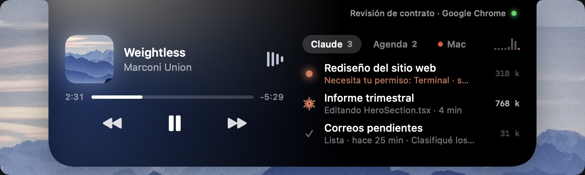
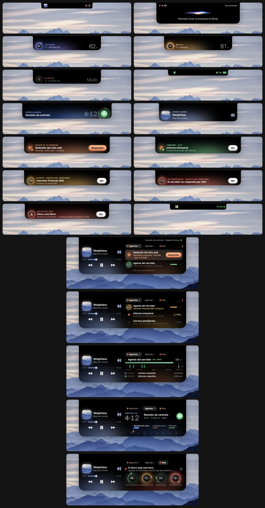
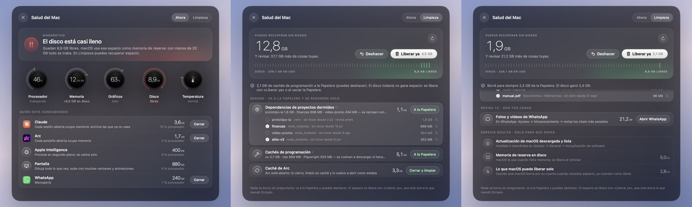
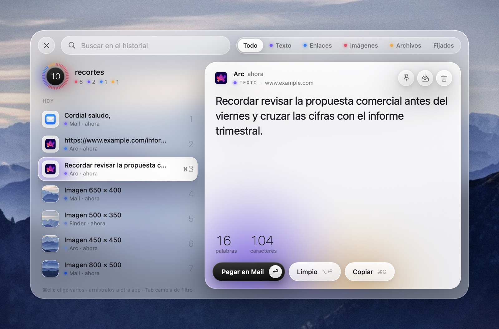
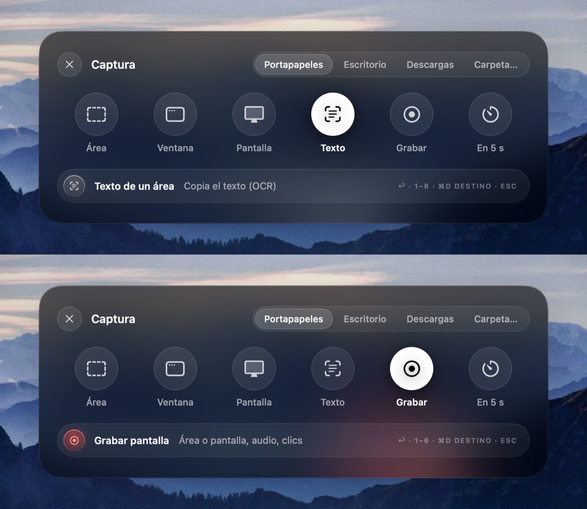
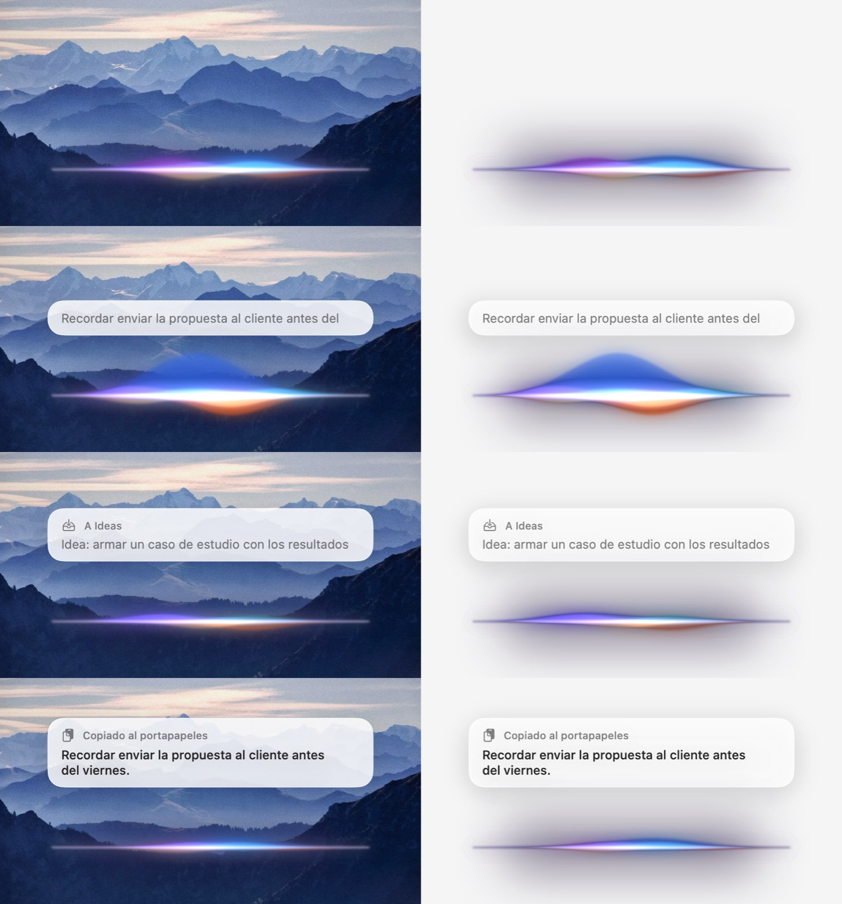

# Dictado

Una sola app nativa de macOS, liviana (unos 40 MB de memoria y 0 % de procesador en reposo), que reemplaza media docena de utilidades. Incluye:

- **Dictado por voz** local, que pega donde está el cursor.
- **Portapapeles** con historial.
- **Capturas** de pantalla con OCR.
- **Una isla en el notch (y en cada monitor)** con música, agenda, llamadas, sesiones de Claude Code, agentes remotos, volumen y brillo.
- **Un monitor y limpiador del Mac** honesto.

Todo funciona en el Mac, sin cuentas, sin suscripciones y sin mandar tu voz ni tus archivos a ningún servidor.



> **Instalación en un paso:** abre [Claude Code](https://claude.com/claude-code) en esta carpeta y escribe *«instala y configura Dictado»*. Claude sigue las instrucciones de [`CLAUDE.md`](CLAUDE.md), te hace tres preguntas y te guía con los permisos.

---

## Qué hace

| | Cómo se usa | Reemplaza a |
|---|---|---|
| **Dictado** | Mantén **⌥Espacio**, habla y suelta: el texto se pega donde está el cursor (en cualquier app). **⌥⇧Espacio** guarda la idea como nota en tu carpeta de ideas. **Esc** cancela. | Handy, superwhisper, MacWhisper |
| **Portapapeles** | **⌘⌥V**. Historial con búsqueda, filtros, varios elementos a la vez (⌘clic), arrastrar a otras apps, cuadrícula de imágenes, pegado con o sin formato, ⌘1–9. Cada tipo lleva un punto de color discreto y la vista previa muestra sus datos: palabras y caracteres, tamaño, proporción y paleta de una imagen, ruta y parámetros de un enlace, peso de los archivos. Ignora contraseñas. | Raycast, Paste, Maccy |
| **Captura** | **⌘↩**. Área, ventana, pantalla, texto de una zona (OCR), grabación y temporizador. Destino: portapapeles, Escritorio, Descargas o una carpeta. | CleanShot X (lo básico), TextSniper |
| **Isla del notch** | Siempre visible, en todas tus pantallas: en el MacBook sobre el notch; en un monitor externo hace de notch arriba al centro, del alto de su barra de menús. Al pasar el mouse se abre la de esa pantalla. | Atoll, NotchNook, Boring Notch |
| **Salud del Mac** | Pestaña **Mac** de la isla (el ícono ↗ abre el panel) o el menú de Dictado. | CleanMyMac, iStat Menus |
| **Centro de mando** (opcional) | **Hyper + A** (abre y cierra), menú de Dictado → *Centro de mando…* o `Dictado --abrir-centro` desde un atajo. Un espacio al estilo visionOS (ventanas de vidrio en curva sobre tu fondo de pantalla) con **Hoy** (el brief del día: foco, prioridades, finanzas en resumen y noticias), **Metas** (semana, mes y trimestre), **Orquesta** (tus agentes y tus sesiones de Claude Code) e **Inbox** (tus capturas con un clic). Lee el estado con un comando tuyo; cerrada no corre nada. [Ficha](docs/CENTRO.md) | Paneles de "AI OS" en web o Electron |
| **Dictado pulido con IA local** (opcional) | Automático al dictar: el modelo de Apple en el Mac quita muletillas y arregla la puntuación, con el tono de la app al frente (chat, correo, prompt, documento). [Ficha](docs/FUNCIONES.md#dictado-pulido-con-ia-local) | Wispr Flow, superwhisper (modos) |
| **Acciones sobre texto seleccionado** (opcional) | **Hyper + T** sobre un texto: traducir, corregir, resumir, más formal, mandar a Claude o guardar como idea; luego Reemplazar o Copiar. [Ficha](docs/FUNCIONES.md#acciones-sobre-texto-seleccionado) | PopClip, Raycast AI |
| **Tecla hyper** (opcional) | Mantén **Bloq Mayús** junto con otra tecla = ⌃⌥⌘⇧, para atajos que no chocan con nada; sola sigue activando las **mayúsculas**. Hyper + V portapapeles, + C captura, + M Salud del Mac, + U unirse a la reunión, + A centro de mando. | Hyperkey, Karabiner (lo básico) |
| **Ventanas por teclado** (opcional) | **Hyper + ←/→**: mitad, tercio y dos tercios. **↑** casi maximizar, **↓** restaurar, **N** otra pantalla, **↩** centrar. En un monitor vertical: **↑/↓** mitad de arriba o de abajo (y tercios), **←/→** a la pantalla de al lado, **↩** casi maximizar. **Hyper + D** junta la ventana al frente y la anterior (⅔ + ⅓, al repetir ½ + ½ y ⅓ + ⅔). | Rectangle, Magnet |
| **Buscador de ventanas** (opcional) | **Hyper + Espacio**: escribe parte del título o de la app y salta a la ventana, aunque esté minimizada. | Contexts, AltTab |

Las funciones marcadas como opcionales (y la de quitar descargas de iCloud en Limpieza) se prenden o apagan en el menú **Funciones** de Dictado. Qué hace cada una, qué archivos toca y cómo quitarla del todo está en [`docs/FUNCIONES.md`](docs/FUNCIONES.md).

### La isla



Hay una isla en cada pantalla conectada. Lo que muestra (el dictado, los avisos, la música, el volumen) sale en todas a la vez; abrirla con el mouse es de cada una. En un monitor sin notch la isla se dibuja como un notch del alto de su barra de menús: de 180 puntos en uno horizontal y de 64 en uno vertical (su barra de menús es corta y taparía los menús). Al conectar o desconectar pantallas se acomoda sola.

Toda la app habla un mismo idioma visual, **Halo**: negro de fondo, diales de marcas finas que se encienden, cifras grandes y delgadas, y una luz de color que nace del borde de abajo solo cuando algo pide atención (naranja si Claude te espera, ámbar o rojo si un agente avisa, el color de la carátula con la música). Un tono por momento; lo demás, blanco. En reposo no anima nada (0 % de procesador); las animaciones solo acompañan un cambio. Reglas, piezas y movimiento en [`docs/DISENO.md`](docs/DISENO.md) (y el [video de las animaciones](docs/halo-animaciones.mp4)).

- **Música:** Spotify con carátula, progreso y controles; cuando cambia la canción aparece "Ahora suena". Si suena otra cosa (un video de YouTube en el navegador, Música, un podcast), la isla lo detecta y muestra qué es y dónde (del título de la ventana), con pestañas para pasar de una fuente a otra, reproducir o pausar e ir a la app. El botón con el ícono de la salida (altavoces, AirPods, pantalla, AirPlay) cambia por dónde suena el Mac. Todo con CoreAudio y Accesibilidad, sin permisos nuevos y solo con la isla abierta.
- **Agenda:** la próxima reunión como protagonista, con la cuenta regresiva en números de puntos y el botón **Unirse**, y el resto del día en una línea de tiempo con la hora actual marcada. Lee el Calendario de macOS (también Google si agregas la cuenta en Ajustes → Cuentas de internet). A los 5 minutos de una reunión sale un aviso con la cuenta regresiva y el botón para unirte al Meet, Zoom o Teams del evento.
- **Llamadas:** cuando una app usa el micrófono o la cámara, la isla muestra el ícono de la app, un cronómetro verde y el punto verde (cámara) o naranja (micrófono), como en el iPhone.
- **Agentes:** en una sola pestaña, tus sesiones de Claude Code y tus [agentes remotos](#agentes-remotos), primero lo que necesita atención.
  - Por cada sesión de Claude: qué está haciendo ("Editando App.swift · 4 min"), qué te pide (permiso o pregunta, resaltado en naranja) y el contexto del chat. El clic abre justo esa sesión. Arriba, los tokens del día por hora.
  - Por cada agente remoto, una fila como la de una sesión: un dial pequeño (verde, ámbar o rojo), cómo va el día ("5 de 6 hoy · próxima 3:00 a. m.") o la alerta, y una cápsula con lo que ya corrió. Al tocarla se abre su día: lo que corrió como marcas sobre la regla de medianoche a medianoche y las tareas que importan (la que falló, la que corre, la última y la próxima).
  - Avisos: cuando una sesión te necesita o termina, y cuando un agente remoto tiene una alerta nueva (con **Ver**, que abre el día de ese agente).

  De Claude se lee `~/.claude` en solo lectura.
- **Mac:** cuatro diales (procesador, memoria, gráficos y disco) cuyo resplandor sube con la gravedad, el titular del diagnóstico y el ícono ↗ que abre Salud del Mac.
- **Volumen y brillo:** las teclas del teclado muestran algo en el notch en lugar del cuadro de macOS. El volumen es una línea muy fina con un parlante en cada punta (bajar y subir, como en macOS) sobre la que una bruma de luz llega hasta el nivel, con la cifra encima, el botón del parlante y a dónde va el sonido (por ejemplo, tus AirPods); la punta hacia donde lo mueves se enciende un instante. El brillo es una cuña de rayitas que se enciende hasta el nivel. Al mantener la tecla se mueven sin volver a aparecer; en silencio la bruma se apaga, el botón del parlante se pone rojo y el punto queda en el volumen guardado.
- **Cargador, dictado en vivo y avisos de salud** del Mac.

### Agentes remotos

Si tienes agentes trabajando fuera del Mac (por ejemplo, un agente en un servidor con tareas programadas), la pestaña Agentes los muestra junto a Claude Code. Dictado solo **lee** su estado: ejecuta un comando que tú configuras y que imprime JSON (cada 10 minutos y al abrir la pestaña, como mucho una vez cada 2 minutos; máximo 20 segundos por consulta).

```bash
defaults write app.dictado agentes -array '{ nombre = "Mi agente"; comando = "ssh mi-servidor cat /ruta/estado.json"; }'
```

El comando debe imprimir algo así (todo es opcional salvo `estado`):

```json
{
  "estado": "ok",
  "resumen": "10 tareas activas · todo bien",
  "alertas": ["informe-diario falló: el servidor de correo no respondió"],
  "tareas": [
    { "nombre": "informe-diario", "estado": "ok", "ultima": "2026-10-09T08:03:07-05:00",
      "proxima": "2026-10-10T08:00:00-05:00", "detalle": "todos los días a las 8" }
  ]
}
```

- `estado` del agente: `ok`, `alerta` o `caido`. Estado de cada tarea: `ok`, `error`, `pausada` o `corriendo`. Las fechas van en ISO 8601.
- Cada alerta nueva aparece una vez como aviso en la isla.
- Para probarlo sin abrir la isla: `.build/release/Dictado --agentes` (o `~/Applications/Dictado.app/Contents/MacOS/Dictado --agentes`).
- Si no configuras ninguno, la pestaña muestra solo las sesiones de Claude Code.

### Salud del Mac



- **Ahora:** un semáforo con la causa en una frase ("El disco está casi lleno", "La memoria está al límite: Claude usa 3,6 GB"). Tiene anillos de procesador, memoria (presión real), gráficos, disco y temperatura, y muestra **quién está consumiendo**: las apps con todos sus procesos sumados y los servicios del sistema explicados en palabras simples.
- **Limpieza honesta**:
  - **Seguro:** cachés de apps cerradas, cachés internas de apps tipo Chrome/Electron, cachés de programación (uv, npm, Playwright…), dependencias (`node_modules`, `.venv`) de proyectos sin tocar hace 60 días, registros y versiones viejas. Todo va **a la Papelera** y se puede **deshacer**. Cada categoría se despliega para marcar y desmarcar elemento por elemento.
  - **Cerrar y limpiar:** para apps abiertas con cachés grandes (como Arc), las cierra como ⌘Q, limpia y las vuelve a abrir como estaban.
  - **Revisa tú:** lo que es tuyo (fotos de WhatsApp, Notas de Voz, archivos grandes o duplicados, descargas viejas, apps grandes) **nunca se borra solo**: te muestra cuánto ocupa y te lleva al lugar.
  - **Nunca toca:** contenedores de otras apps, nada que esté en uso, ni tus carpetas protegidas; de iCloud solo quita descargas, nunca borra. Tampoco hace "liberar RAM", escaneos de malware de mentira ni cambios al sistema.
  - **Liberar ya:** borra para siempre solo lo que Dictado mandó a la Papelera (por defecto, lo de más de 7 días), siempre preguntando con el tamaño, y cada limpieza dice cuánto espacio ganó el disco de verdad.
  - **Quitar descargas de iCloud** (opcional, menú Funciones): archivos de 50 MB o más que ya están en iCloud y no abres hace una semana; siguen en la nube y se descargan al abrirlos.
  - **Espacio oculto:** te dice, en palabras simples, si hay una actualización de macOS descargada, cuánta memoria de reserva hay en disco y cuánto puede liberar macOS solo.
- **Avisos en la isla** si el disco baja de 10 GB, la memoria llega al límite, el Mac se calienta, una app pasa 2 minutos al máximo o lo que Dictado dejó en la Papelera ya suma 1 GB con el disco justo.

### Portapapeles, captura y dictado







---

## Instalación

### Con Claude Code (recomendado)

```bash
git clone https://github.com/juanth11/dictado.git
```

```bash
cd dictado && claude "instala y configura Dictado"
```

Claude revisa los requisitos, compila, instala, te pregunta tu idioma, tu carpeta de ideas y las palabras que más usas, y te guía para dar los permisos. Los pasos exactos están en [`CLAUDE.md`](CLAUDE.md).

### A mano

**Requisitos:** Mac con Apple Silicon, **macOS 26 o posterior** y las herramientas de línea de comandos de Apple. No hace falta Xcode completo. Si no las tienes, instálalas con:

```bash
xcode-select --install
```

1. **(Recomendado) Crea un certificado para firmar.** Así macOS recuerda los permisos entre actualizaciones. Abre **Acceso a Llaveros** → menú Acceso a Llaveros → Asistente de certificados → **Crear un certificado…**. Nombre: `Dictado Local`. Tipo de identidad: **Raíz autofirmada**. Tipo de certificado: **Firma de código**. Luego, Crear.
2. **Compila e instala** en `~/Applications/Dictado.app` y ábrela:

   ```bash
   ./instalar.sh
   ```
3. **Da los permisos** que pide (Ajustes del Sistema → Privacidad y seguridad):
   - **Micrófono**, para dictar.
   - **Accesibilidad**, para pegar, usar las teclas de volumen y brillo y que los botones de la isla respondan al primer clic.
   - **Calendarios**, para la agenda y el botón Unirse.
4. Opcional: en el menú de Dictado, marca **Abrir al iniciar sesión**.

Para revisar que todo quedó bien:

```bash
cat ~/Library/Application\ Support/Dictado/estado.txt
```

## Personalización

| Qué | Cómo |
|---|---|
| Idioma del dictado | `defaults write app.dictado idioma es-MX` (por defecto `es-US`; también `es-ES`, `en-US`…) |
| Carpeta de ideas (⌥⇧Espacio) | `defaults write app.dictado inbox "$HOME/Documents/Ideas"`. Si la carpeta está en un repositorio git, cada idea se guarda con commit. |
| Carpetas que la limpieza no toca | `defaults write app.dictado protegidas -array "$HOME/Documents/Trabajo"` |
| Nombres y términos que el dictado debe reconocer | Edita `~/Library/Application Support/Dictado/vocabulario.txt` (menú → Editar vocabulario…) |
| Correcciones automáticas | `~/Library/Application Support/Dictado/correcciones.txt`, una línea por regla con la forma `lo que transcribe = lo correcto` |
| Estilo del indicador de dictado | Menú → Estilo (Prisma por defecto) |
| Volumen y brillo en la isla | Menú → Volumen y brillo en la isla |
| Agentes remotos en la pestaña Agentes | `defaults write app.dictado agentes -array '{ nombre = "Mi agente"; comando = "…"; }'` (ver [Agentes remotos](#agentes-remotos)) |

Después de cambiar un ajuste con `defaults`, reinicia Dictado (menú → Salir y ábrela de nuevo).

## Privacidad

- La voz se transcribe **en el Mac** con el modelo de Apple (SpeechAnalyzer) y no se guarda ningún audio.
- El pulido del dictado y las acciones sobre texto (traducir, corregir, resumir) también corren en el Mac, con el modelo y la traducción de Apple. Solo "A Claude" manda el texto a Claude, cuando lo eliges.
- El portapapeles vive en `~/Library/Application Support/Dictado/Portapapeles` y salta lo que las apps marcan como contraseña.
- Lo único que sale a internet es la consulta de la carátula de Spotify (el oEmbed público de Spotify).
- La parte de Claude Code **solo lee** `~/.claude/sessions` y los transcriptos; nunca escribe ahí.
- Los agentes remotos se leen con el comando que tú configuras; Dictado no se conecta a ningún servidor por su cuenta.
- La limpieza mueve a la Papelera y anota cada movimiento en `limpiezas.json` para poder deshacer. Borrar para siempre lo decides tú: «Liberar ya» solo borra lo que mandó Dictado y pregunta antes.

## Cómo está hecho

Es un paquete de Swift (Swift 6, SwiftUI y AppKit), sin dependencias externas, que se compila con `swift build`. `instalar.sh` arma el `.app`, lo firma y lo copia a `~/Applications`.

| Archivo | Qué contiene |
|---|---|
| `App.swift` | Menú, atajos, flujo del dictado |
| `Transcripcion.swift`, `Salida.swift` | Voz a texto, pegado e ideas |
| `Portapapeles.swift`, `VistaPortapapeles.swift` | Historial y panel |
| `Captura.swift` | Panel de capturas y OCR |
| `Isla.swift`, `VistaIsla.swift` | La isla del notch (música, agenda, llamadas, actividades, pestañas Agentes, Agenda y Mac) |
| `DialesIsla.swift` | Lenguaje visual de la isla: diales con marcas finas, resplandores, números finos y de puntos |
| `Claude.swift`, `Agentes.swift`, `VistaAgentes.swift` | Sesiones de Claude Code (solo lectura), agentes remotos (lector del JSON que imprime tu comando) y el detalle del día de cada agente |
| `Privacidad.swift`, `Niveles.swift` | Cámara y micrófono en uso; volumen y brillo |
| `Salud.swift`, `VistaSalud.swift`, `Papelera.swift`, `ICloud.swift` | Medidor, escáner de limpieza, bitácora para deshacer, "Liberar ya" y descargas de iCloud |
| `HUD.swift`, `Estilos*.swift`, `Diseno.swift` | Indicador de dictado y lenguaje visual |
| `TeclaHyper.swift`, `Ventanas.swift`, `BuscadorVentanas.swift`, `VistaBuscador.swift` | Tecla hyper, ventanas por teclado y buscador de ventanas (pruebas en `PruebasTeclado.swift`) |
| `PulidoIA.swift`, `AccionesTexto.swift`, `VistaAcciones.swift`, `IALocal.swift` | Dictado pulido y acciones sobre texto seleccionado con el modelo de Apple en el Mac |
| `Funciones.swift` | Registro de funciones opcionales, interruptores del menú Funciones y lo que cada módulo puede usar de la app |
| `MaquetaVerme.swift` | Maqueta (solo render) del espejo de cámara «Verme», no integrada a la app |
| `Pruebas.swift`, `CLI.swift` | Renders de las vistas y diagnósticos (`--salud`, `--claude`, `--agentes`, `--vista-isla salida.png`, `--vista-agentes salida.png`) |

## Desinstalar

1. Menú de Dictado → Salir.
2. Mueve `~/Applications/Dictado.app` a la Papelera.
3. Si quieres, borra también `~/Library/Application Support/Dictado` y los ajustes con `defaults delete app.dictado`.

## Licencia

[MIT](LICENSE).
