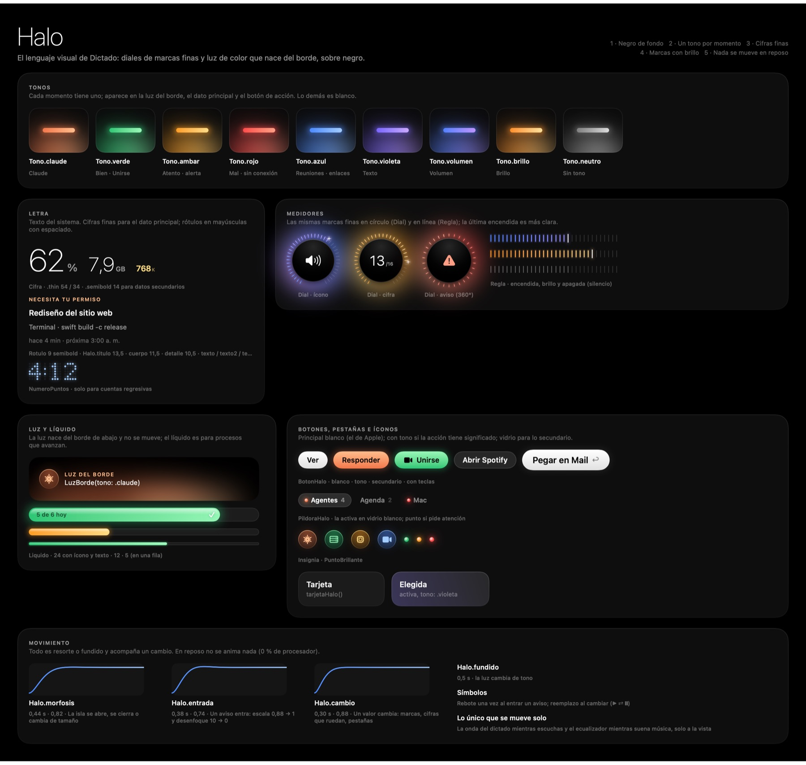

# Halo: el diseño de Dictado

Halo es el lenguaje visual de toda la app: la isla del notch y los paneles (portapapeles, Salud del Mac, captura, buscador de ventanas, acciones sobre texto). Junta dos ideas:

- **Diales de marcas finas.** Anillos de rayitas que se encienden, con cifras grandes y delgadas.
- **Luz de color.** Nace del borde de abajo, como el reproductor de iOS cuando se tiñe con la carátula.

El código vive en `Sources/Dictado/Halo.swift` (tonos, letra, movimiento y piezas) y `DialesIsla.swift` (dial, marcas, resplandor, números de puntos).

## Las cinco reglas

1. **Negro de fondo.** La isla es negro puro y se funde con el notch. Los paneles son vidrio oscuro (Liquid Glass teñido de negro) con un filo de luz arriba.
2. **Un tono por momento.** Cada cosa tiene un solo tono y aparece en tres lugares como máximo:
   - la luz del borde;
   - el dato principal (marcas, líquido);
   - el botón de acción.

   Todo lo demás es blanco con opacidad. La luz solo aparece cuando algo pide atención: en calma, la isla abierta solo se tiñe con la música.
3. **Cifras finas, letra del sistema.** El dato principal va grande y delgado (`.thin`). Los títulos van en seminegrita de 13,5. Los rótulos van en mayúsculas pequeñas con espaciado, nunca monoespaciados.
4. **Marcas con brillo.** El mismo trazo fino sirve para diales (`Dial`, en círculo) y reglas (`Regla`, en línea). Las encendidas brillan y la última es más clara.
5. **Nada se mueve en reposo.** La isla quieta usa 0 % de procesador. Las animaciones solo acompañan un cambio.

Todo es fino y riguroso:
- trazos de 1 punto o menos;
- márgenes en una rejilla de 4 y 8 puntos;
- nada cortado ni apretado.

Si una pantalla se ve recargada, se quita color antes que agregar elementos.

## Tonos

| Tono | Para qué |
|---|---|
| `Tono.claude` | Sesiones de Claude Code, "Responder" |
| `Tono.verde` | Bien, terminó, "Unirse", cargando |
| `Tono.ambar` | Atento, alerta de un agente |
| `Tono.rojo` | Mal, sin conexión, disco lleno |
| `Tono.azul` | Reuniones (si el evento no trae su color) |
| `Tono.violeta` | Texto del portapapeles |
| `Tono.volumen` · `Tono.brillo` | Las teclas de volumen y brillo |
| `Tono.neutro` | Sin tono |
| `Tono.de(color)` | El de una carátula o un evento: su color, aclarado para brillar sobre negro |

Cada tono tiene `base` y `claro`. Las marcas, el líquido y la luz van del uno al otro.

## Piezas

| Pieza | Qué es | Dónde |
|---|---|---|
| `LuzBorde` | Luz del tono que sube desde el borde de abajo (estática) | Avisos de la isla, isla abierta, vista previa del portapapeles, cabecera de Salud |
| `Dial` | Anillo de marcas que se enciende, disco negro, resplandor y destello en el valor | Mac, avisos de Salud y de agentes, fila de un agente |
| `Cuna` | Rayitas que suben de izquierda a derecha sobre una cuadrícula tenue, encendidas hasta el nivel, con la luz debajo y un marcador blanco | Brillo |
| `ArcoTubo` | Arco de termostato: un tubo con volumen (sombra abajo, brillo arriba) que se enciende de azul a violeta, naranja y rojo hasta el nivel, con una perilla blanca que brilla y la cifra con relieve en el centro | Volumen |
| `BotonVidrio` | Botón redondo de vidrio oscuro con relieve; con tinte, brilla de ese color (rojo en silencio) | Volumen |
| `VolumenNiebla` | La onda del sonido como niebla de luz hasta el nivel, línea punteada con la cifra encima y rayitas tenues después | Volumen (estilo `niebla`) |
| `VolumenCalor` | Línea fina con topes: brillo cálido hasta el nivel (centro blanco) y frío después; "VOLUMEN 62" arriba, 0 y 100 abajo | Volumen (estilo `calor`) |

El volumen tiene tres estilos: `termostato` (el de siempre), `niebla` y `calor`. Se elige con `defaults write app.dictado estiloVolumen niebla` y cambia al instante, sin reiniciar.
| `Regla` | Las mismas marcas en línea | Niveles y medidas pequeñas |
| `Liquido` | Cápsula de progreso que brilla, con reflejo e ícono o texto | El día de un agente, espacio liberado |
| `Cifra`, `NumeroFino` | Cifra con su unidad en versalitas | Todo dato principal |
| `NumeroPuntos` | Cifra en matriz de puntos | Solo cuentas regresivas (reuniones) |
| `Insignia` | Ícono en un círculo de vidrio teñido | La sesión que te espera, medidas, filas |
| `BotonHalo` | Blanco sólido (principal); con tono si la acción significa algo; vidrio (secundario) | Ver, Responder, Unirse, Pegar |
| `PildoraHalo`, `Segmentado` | Pestañas: la activa en vidrio blanco; un punto si pide atención | Isla abierta, paneles |
| `tarjetaHalo(activa:tono:)` | Tarjeta dentro de un panel; la activa se levanta | Filas elegidas, vista previa, secciones |
| `panelHalo` | Vidrio oscuro del panel | Todos los paneles |
| `PuntoBrillante` | Punto de estado con brillo | Pestañas, filas, tareas |

## Movimiento

| Nombre | Resorte | Cuándo |
|---|---|---|
| `Halo.morfosis` | 0,44 s · amortiguación 0,82 | La isla se abre, se cierra o cambia de tamaño |
| `Halo.entrada` | 0,38 s · 0,74 (rebote leve) | Un aviso entra: crece desde el notch (escala 0,88 → 1), se enfoca (desenfoque 10 → 0) y aparece |
| `Halo.cambio` | 0,30 s · 0,88 | Un valor cambia: las marcas se encienden, las cifras ruedan (`.numericText`), cambia una pestaña |
| `Halo.fundido` | 0,5 s, suave al final | La luz cambia de tono |

**Además:**
- **Íconos:** rebotan una vez al entrar un aviso y se reemplazan con efecto al cambiar (▶︎ ⇄ ❙❙).
- **Lo único que se mueve solo:** la onda del dictado mientras escuchas y el ecualizador mientras suena música. Las dos, solo mientras están a la vista.

El video [`halo-animaciones.mp4`](halo-animaciones.mp4) se genera con `Dictado --animaciones carpeta` y ffmpeg. Muestra cada animación con estos mismos resortes.

## Tamaños

**Isla abierta:** 600 × 200 puntos.

**Avisos:** el notch más un alto extra.

| Aviso | Alto extra |
|---|---|
| Brillo | 44 |
| Volumen (el arco necesita un poco más) | 52 |
| Salud del Mac y agentes | 50 |
| Reunión | 52 |
| Claude y "Ahora suena" | 58 |

Dentro de la isla abierta:
- el reproductor mide 212 de ancho;
- el resto es la pestaña;
- márgenes: 26 a los lados, 14 abajo.

## Ver cada pantalla sin instalar

| Comando | Qué dibuja |
|---|---|
| `Dictado --vista-halo salida.png` | Esta hoja del sistema |
| `Dictado --vista-isla salida.png` | Todos los estados de la isla |
| `Dictado --vista-agentes salida.png` | Avisos, pestaña Agentes y el día de un agente |
| `Dictado --vista-portapapeles salida.png [lista\|enlace\|imagen\|largo\|archivo\|codigo\|color]` | Portapapeles |
| `Dictado --vista-salud salida.png` | Salud del Mac |
| `Dictado --vista-captura`, `--vista-acciones`, `--vista-buscador`, `--vista-hud` | Los demás paneles y el HUD de dictado |
| `Dictado --foto-real foto.json` + `--comparar salida.png halo foto.json` | La isla con tus datos de verdad |

Con `DICTADO_FONDO=ruta.jpg` el fondo de los renders es esa imagen.
